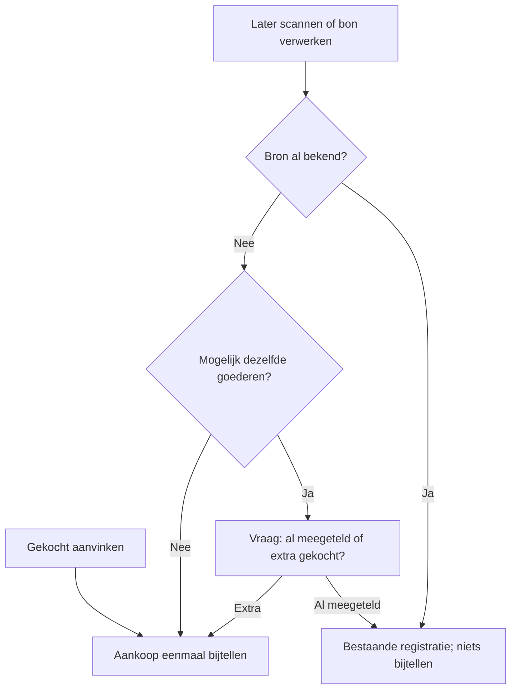
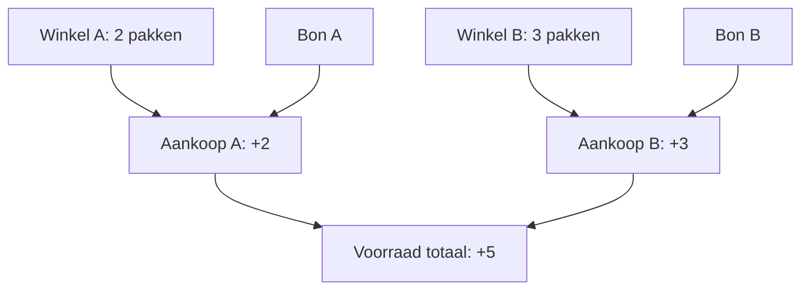

# Aankopen één keer tellen, voorraad eenvoudig controleren

<Callout type="decision">
Lokaal geïmplementeerd: ‘Gekocht’ telt voorraad automatisch bij wanneer locatie en eenheid duidelijk zijn. Scans en bonnen gebruiken dezelfde aankoopregistraties. Bij mogelijke overlap vraagt de app of het dezelfde aankoop of iets extra’s is. De voorraadtelling heeft een eigen schermvullende telronde. Nog niet gedeployed.
</Callout>

<Matrix>
| Handeling | Gedrag | Status |
|-----------|--------|--------|
| Gekocht aanvinken | Eenmaal automatisch bijtellen | Lokaal |
| Opnieuw aanvinken | Voorraad blijft behouden | Lokaal |
| Latere scan of bon | Koppelen of extra bevestigen | Lokaal |
| Dezelfde bon uploaden | Herkend via inhoudshash | Lokaal |
| Oude bon na telling | Vragen of al meegeteld | Lokaal |
| Voorraadtelling | Aantal per plek vervangen | Lokaal |
</Matrix>

<Phase title="Schermvullende telronde" status="done">

- Eigen pagina via Voorraad → Voorraadtelling; kies een ruimte of alle locaties.
- Eén product per stap, foto, voortgang per ruimte, aanmoediging en afsluitende trofee.
- Bewaar elk geteld aantal meteen; leeg is onbekend, expliciet nul is nul, overslaan wijzigt niets.
- Bij gelijktijdige wijzigingen: vernieuw het geregistreerde aantal en behoud de ingetypte telling voor controle.
- Afronding toont getelde, gewijzigde en overgeslagen producten; overgeslagen producten kun je opnieuw doorlopen.

</Phase>

<Phase title="Aankopen en bewijs eenmaal verwerken" status="done">

- De server bewaart aankopen en bronverwijzingen samen met de voorraadbeweging in één transactie.
- Vaste bronidentiteiten voorkomen dubbel bijtellen bij herhaling; gelijktijdige aanvragen worden vergrendeld.
- Een bonregel kan aan meerdere eerdere aankopen worden gekoppeld als het totaal klopt. Hoeveelheidsverschillen stoppen voor controle.
- Een barcode identificeert een product; mogelijke overlap vraagt daarom een begrijpelijke keuze van de gebruiker.
- MCP `inventory_purchases` controleert eerdere aankopen; `inventory_record_purchase` boekt of koppelt dezelfde goederen.
- Een bevestigde telling bewaart ook het telmoment wanneer het aantal onveranderd is. Een oudere bon vraagt of die goederen in de telling zaten.
- Een geplande winkel kan door de werkelijk bevestigde winkel op de bon worden vervangen.

</Phase>

<Callout type="note">
Grenzen: aanvinken koopt de hele getoonde hoeveelheid. Voor een afwijkende aankoop pas je eerst de hoeveelheid aan of registreer je die aankoop via MCP. Er is geen automatische bonherkenning in deze wijziging: de gekoppelde AI leest de bon en gebruikt de aankooptools. Uitgaven blijven een afzonderlijke registratie. Ongelijke aantallen worden niet stilzwijgend gecorrigeerd.
</Callout>
