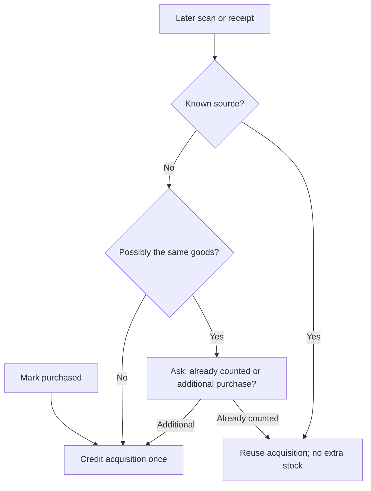
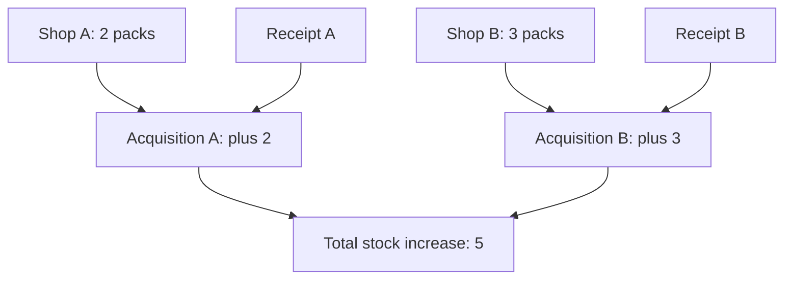

# Count each purchase once and check stock simply

<Callout type="note">
Historical implementation plan, translated into English. Its completed phases describe the recorded purchase/counting work, not a fresh deployment assessment. The current cross-feature redesign is in `docs/plans/app-samenhang/plan.mdx`; the implementation report is `docs/SHOPPING-SESSIONS.md`. The existing filename is retained for link compatibility.
</Callout>

<Matrix>
| Action | Behaviour | Recorded status |
|---|---|---|
| Mark purchased | Credit once | Implemented |
| Mark again | Preserve stock | Implemented |
| Later scan/receipt | Link or confirm extra | Implemented |
| Same receipt upload | Recognise content hash | Implemented |
| Receipt predates count | Ask about overlap | Implemented |
| Count stock | Replace location count | Implemented |
</Matrix>

<Phase title="Full-screen counting journey" status="done">

- Open Inventory → Count stock and choose a room or all locations.
- One product per step, photo, room progress, encouragement and a completion moment.
- Save each count immediately. Empty means unknown, explicit zero means zero, and skipping changes nothing.
- On concurrent changes, refresh the recorded quantity while retaining the typed count for review.
- The summary separates counted, changed and skipped products; skipped products can be revisited.

</Phase>

<Phase title="Process acquisitions and evidence once" status="done">

- Store acquisition, source references and stock movement in one transaction.
- Stable source identities prevent duplicate credits on retries; concurrent requests are locked.
- A receipt line may link several earlier acquisitions when quantities reconcile. Differences stop for review.
- A barcode identifies a product, not a unique purchase. Possible overlap therefore needs a clear household choice.
- MCP `inventory_purchases` checks history; `inventory_record_purchase` records or links the goods.
- A confirmed count records its timestamp even when quantity is unchanged. Older receipts ask whether those goods were already included.
- The confirmed receipt shop may replace the planned shop.

</Phase>

<Callout type="note">
At this implementation stage, marking purchased buys the displayed quantity. Adjust it first or record a different acquisition through MCP. Later shopping-session work adds cumulative partial quantities. This change introduced no automatic OCR parser: a connected AI reads the receipt and uses acquisition tools. Expenses remain separate financial records. Quantity differences are never silently corrected.
</Callout>
