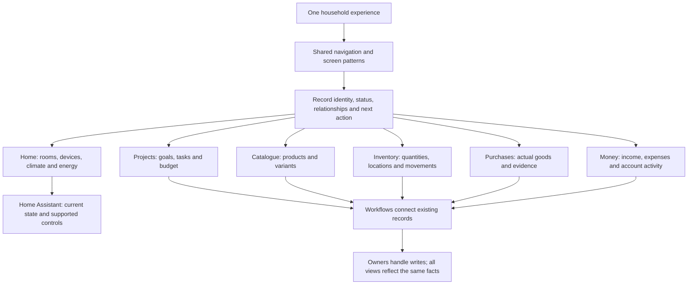
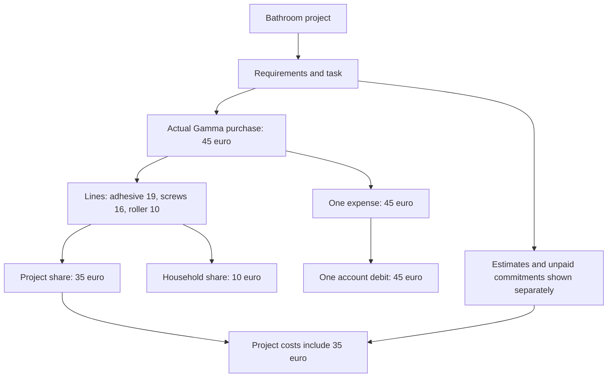
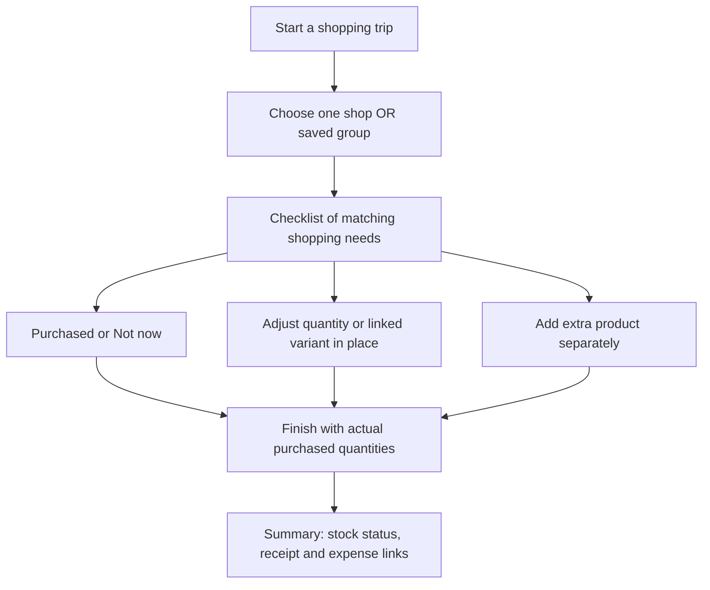
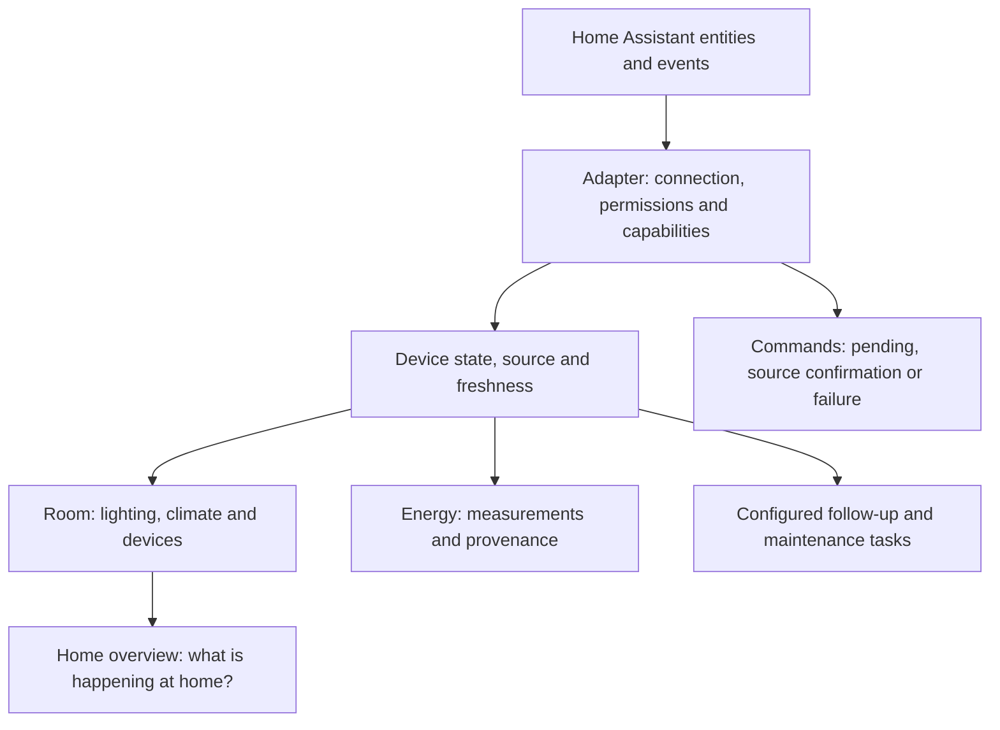

# One WickedHome — connected features, familiar controls

Shared foundations and reference journeys are implemented; the full rollout is incomplete: see [current implementation](./implementation.md) for the local implementation and validation evidence.

This complete redesign replaces the earlier shopping-only proposal. Every fact has an owner; every feature exposes useful relationships; every screen uses the existing component library. The atlas includes 178 page and dialog variants covering 65 existing routes, 62 existing dialogs and all 29 feature directories. English is the default language, with Dutch supported throughout. Proposed pages are clearly identified.



## 1. What changes across the product

| Observed problem | Underlying cause | Design rule |
|---|---|---|
| Shopping trips appears as an isolated link above Shopping | Related navigation is added as arbitrary content | Real hierarchy above the title; stable local navigation below it |
| Group dropdown plus tiny shop checkboxes | Established selection patterns are bypassed | One shop or saved group, with favourites and recent choices |
| Session creation asks for names, recalculation and product selection | Internal capabilities dictate the user journey | Start, choose destination, use checklist, finish |
| Project, money and shopping pages accumulate unrelated blocks | Each relationship gets another custom layout | Consistent record structure with related views supplied by their owners |
| Buttons and cards are reused but whole pages look unrelated | Primitive reuse is mistaken for composition reuse | Reuse selection, form, list, navigation and state patterns too |

<Callout type="decision">

This is an application-wide design model. Shopping and project purchases are reference journeys for the whole product. The local implementation follows this model through shared compositions and existing owner services; the implementation report records the resulting flows and validation.

</Callout>

## 2. Navigation and page grammar

```text
DESKTOP                                   MOBILE
Brand / Search or quick action            Brand / Search / Notifications
Daily life                                Current page and primary action
  Today · Tasks · Projects                Content and relevant next step
  Shopping · Inventory · Recipes          Local tabs / related records
  Calendar                                Today · Tasks · Shopping · Home · More
Money
  Cash flow · Income · Expenses · Purchases
Home and library
  Our home · Spaces · Devices · Energy
  Products · Shops and groups · Documents
Manage / Assistant / Account
```

| Page type | Consistent structure | Examples |
|---|---|---|
| Overview | Title, one primary action, relevant summary, search/filters, list/cards | Tasks, products, projects, expenses |
| Record | Breadcrumb, identity/status, primary action, related-record cards, focused content | Product, project, expense, room |
| Workspace | Stable record context, progress, one immediate action, optional detail | Shopping checklist, cooking, counting |
| Form/dialog | Context already selected, short primary fields, conditional advanced fields, clear submit | Pay expense, add product, link document |
| Special workspace | Common shell and identity around a dedicated canvas | Floor plan, calendar, chat, energy chart |
| Management | Clear sections linked to owner forms | Household, access, connections, preferences |

Filters refine a list; tabs change a stable local view; related-record cards open the same records at their owners. These controls must not compete for the same meaning. Retain origin, filters and scroll position on the return journey. Daily actions remain reachable on mobile without scrolling past management forms or several summary panels.

## 3. Ownership: one fact, one owner

| Fact or responsibility | Target owner | Contributions to other features |
|---|---|---|
| Product name, category, barcode, unit and verified variants | Catalogue | Reference, select and open with context |
| Shops and saved shop groups | Shops | Select one destination; read the group's shops |
| Stock quantity, location minimum, count, usage and movements | Inventory | Show current quantities; request central stock actions |
| Need from recipe, task, project or minimum stock | Shopping | Preserve source and purpose; reuse the existing requirement |
| Shopping trip, participants and checklist | Shopping | Start/open/finish through the same service |
| Actual purchase lines, evidence and allocation | Purchases | Link an acquisition and allocate it deliberately |
| Project goal, milestones, status and budget settings | Projects | Select a project and attach records with explicit meaning |
| Task, schedule, dependencies and completion | Tasks | Create or display the same task in another context |
| Expense, payment state, amount, payer and allocation | Expenses | Reuse an expense or request owner creation |
| Expected income and actual receipts | Income | Summarise without treating expectations as receipts |
| Accounts, contributions, transfers, adjustments and balance | Money | Select accounts and show traceable summaries |
| File, storage and document links | Documents | Link the same file across records |
| People, spaces, contacts and device identity | Their domain feature | Recognisable selection and related context |
| Live state, source availability and physical commands | Home Assistant adapter and external source | Show supported capabilities and freshness |
| Consumption, tariffs and cost estimates | Energy | Identify measurements and estimates separately from expenses |
| Calendar, dashboard, project budget and AI context | Composed read views | Combine owner facts without becoming another ledger |

<Callout type="note">

Catalogue and Purchases now expose explicit public contracts. Product persistence remains in shopping; acquisition data spans inventory, shopping sessions and expenses. The interfaces reuse existing records. Preserve tables, IDs and history; any later schema move is separately migrated and tested.

</Callout>

A product does not gain a universal project field. A project uses it through a requirement, task, purchase line or actual consumption. Each relationship has a distinct meaning. The [architecture contracts](./architecture-contracts.md) assign all 27 existing features and define their read/write boundaries.

## 4. Make relationships visible

```text
PROJECTS / BATHROOM RENOVATION                         [Next task]
Active · Rob and Cindy · next: install cabinet

[Tasks 3] [Materials 3] [Purchases 2] [Costs €460] [Documents 2]

Together: 1 of 3 tasks completed ━━━━━━━────────────
Budget €2,500   Spent €460   Planned €340   Remaining €1,700

Next achievable step                  What does it need?
Install bathroom cabinet              Adhesive: 2 required · 3 in stock
[Open task]                           [Open product / inventory]
```

```text
PRODUCTS / WHITE MOUNTING ADHESIVE                          [Edit]
DIY materials · unit cartridge · one identity throughout the app

[Stock 3] [Tasks 1] [Projects 1] [Purchases 1] [Shops / variants]

Garage: 3 in stock                    Bathroom requires: 2
Latest purchase: 2 at Gamma            [Open task] [Open project]
```

The related cards open real records using the matching context filter. Counter, list and total share a source and authorisation. Inventory still owns its product-page contribution; the product page hosts it. Unknown is never silently zero. Three cartridges present does not imply that two are reserved.

Odoo informs the visible relationships and familiar list/form/card views. We adapt this to light household administration and short actions. References: [Odoo views](https://www.odoo.com/documentation/19.0/applications/studio/views.html) and [related-field smart buttons](https://www.odoo.com/documentation/master/applications/studio/views.html).

### Related summaries are small navigation cards

Use the existing Card and IconChip composition for icon + label + count/amount. The whole card is a
link. Phones use two columns; desktop fits the cards across the available width. The active subview has
a clear selected treatment and `aria-current`. Counters and routes still come from their owners.

This pattern applies to projects, products, purchases, devices and other related-record summaries.
It stays below the page identity and above list controls. See the [navigation-card contract](./related-records.md)
and [phone example](./preview/wireframes/related-cards-mobile.png).

## 5. Finance without double counting



| Concept | Meaning | Presentation |
|---|---|---|
| Requirement | Something needed | No purchase or bank movement |
| Estimate | Expected cost | Planned; missing amounts stay unknown |
| Purchase | Goods actually acquired | Product lines, source and quantities |
| Stock movement | Actual change at a location | Once, traceable to acquisition or usage |
| Expense/payment | Amount due or paid | Owner payment state, payer and account |
| Project allocation | Which part serves which purpose | Portion of existing cost, not another expense |
| Income | Expected or actually received | Clearly separate statuses |
| Contribution/transfer | Money moving between people/accounts | Not another salary or household income |
| Cash flow | Account history and outlook | Actual balance distinct from projection |

The fictional receipt allocates €35 to the bathroom and €10 to the household. Another €425 project expense makes €460 spent. An unpaid €40 delivery plus €300 tile estimate gives €340 planned; €2,500 − €460 − €340 = €1,700 remaining.

The account example starts at €1,200, receives €2,800 in contributions and pays €1,602: rent €1,000, energy €132, sanitaryware €425 and Gamma €45. Actual balance is €2,398; a further €100 expected payment gives a €2,298 forecast. Household salary income is not added again when the contribution has already reached this account.

<Callout type="risk">

Current project-budget logic excludes materials whose expenses already count. New session payments use another linking table. Existing isolated tests do not prove every crossing case. Before redesign implementation, establish and test the combined contract for mixed receipts, several projects, discounts, rounding, refunds and partial payments.

</Callout>

Purchased materials can be project costs before their payment is linked. Show their provenance and status; do not imply a confirmed bank debit.

## 6. Short, connected workflows

<Phase title="Shopping as the reference journey" status="done">



- Suggest the trip name; do not require an administrative setup form.
- Reuse favourites and recent selections. Manage a group once in Shops.
- Default to the matching needs; no extra product-selection task before the checklist.
- Count jars, packs and pieces without requiring weights.
- Record acquisition centrally. Update known stock locations once; clearly identify goods not yet tracked in stock.
- Skipped items remain unpurchased. The summary cannot add already processed stock again.
- Attach receipts or link existing/new expenses during or after the trip, preserving earlier purchases.

</Phase>

| Journey | Simple user path | Relationships preserved |
|---|---|---|
| Complete task | Open next task → check requirements → finish and record actual use | Project, participants, stock, documents |
| Project purchase | Open requirement → buy → review receipt allocation | Need, acquisition, project share, expense |
| Receive income | Open expected occurrence → confirm actual receipt | Source, date, amount and destination |
| Pay invoice | Open expense → choose payer/account → confirm | Purchase, document, recurrence and project |
| Cook | Choose recipe → check needs → follow steps → review usage | Products, shopping needs and stock |
| Maintain device | Open device → maintenance task → complete | Room, profile, documents and source state |
| File document | Upload/select → review → link existing records | One source file with several document links |
| Import suggestion | Review detected records → resolve matches → confirm | Import source, duplicate prevention, owner actions |

## 7. Connected home as a central pillar



| Context | Useful information and action |
|---|---|
| Our home | Household state, rooms needing attention and useful next action |
| Room | Climate, lighting, devices, tasks and stock in that space |
| Device | Identity, maintenance, documents, actual capabilities and source state |
| Energy | Current measurements, solar/battery context, tariffs and labelled estimates |
| Home modes | Explicitly linked existing Home Assistant scenes with understandable effects |
| Connection management | Mapping, availability, synchronisation and recovery |

- Home Assistant is present in home, room, device and energy contexts, beyond connection settings.
- WickedHome owns identity and household context. Live external state keeps its source and freshness.
- Controls follow real capabilities. Sensor-only appliances do not receive invented start buttons.
- Offline, unavailable, unknown and stale are distinct. Unknown never means zero, off or safe.
- Physical commands show pending, confirmed or failed. Preserve existing alarm and AI authorisation boundaries.
- Configured follow-up may produce a task proposal; arbitrary sensor values do not create financial or stock entries.
- The household app remains useful without a Home Assistant connection.

The atlas includes live-home, room, entity, mapping, mode, connection, energy and device-control views. Reuse and extend the existing connection/cache first. The [official WebSocket documentation](https://contributors.home-assistant.io/core/internals/websocket-api/) describes the event interface.

## 8. Reuse required by ARCHITECTURE.md

| Need | Existing component or owner composition | Contract |
|---|---|---|
| Frame, widths, columns and spacing | AppShell, PageContainer, PageGrid, Stack, Inline | Shared page geometry |
| Identity and hierarchy | PageHeader, BreadcrumbTrail | Only real ancestors above the title |
| Lists/cards | GeneralList and existing domain rows/cards | Familiar search, grouping and state pattern |
| Single record selection | EntityPicker, ShopPicker, ProductPicker, ProjectPicker, PlacePicker | Reuse favourites, recent history, search and recordUse |
| Multiple selection | Deliberate shared extension | Existing EntityPicker is single-select; no invented multi prop |
| Shop or group destination | Proposed shops-owned wrapper around EntityPicker | Typed destination; add group selection-history support |
| Mobile daily navigation | Proposed reusable AppShell composition | Existing mobile menu remains available; no invented bottom-nav prop |
| Forms/dialogs | GeneralForm, GeneralFormDialog, existing domain forms | Preserve validation and conditional fields |
| Progress/feedback | Progress, StatTile, Badge, TimelineList, Card | Actual progress; consistent colour meaning |
| Empty/loading/error/confirmation | EmptyState, ErrorState, SkeletonList, ConfirmDialog | Actionable text and preserved input |
| Relationships and context | Small proposed shared composition | Owner supplies count, route and permissions |

<FileTree>
- modify docs/ARCHITECTURE.md -- formalise ownership and shared compositions
- modify docs/ADDING-A-FEATURE.md -- require the same contracts for additions
- modify src/components/shared/ -- add missing reusable compositions
- modify src/features/shops/ -- destination picker and group management
- modify src/features/shopping/ -- consistent forms, lists and trip workspace
- modify src/features/projects/ -- related records and traceable budget views
- modify src/features/inventory/ -- stock context, usage and central movements
- modify src/features/expenses/ -- payment and allocation ownership
- modify src/features/income/ -- expected versus received
- modify src/features/money/ -- traceable balances and forecasts
- modify src/features/home-assistant/ -- capability and freshness contributions
- modify src/app/ -- navigation and preserved context
- modify ai/ -- matching workflows, context, documentation and evals
- modify stories/ -- approved page and component variants
</FileTree>

This is a proposed implementation map. Browser cross-feature imports use public indexes; backend writes use owner services and explicit transaction boundaries. Shared types run without React. Keep the existing ESLint layer rules. The design catalogue does not become a universal JSON production renderer.

## 9. Playfulness with useful meaning

| Moment | Friendly feedback | Actual source |
|---|---|---|
| Today | Shared progress and an achievable next step | Tasks and schedule |
| Project | Milestones, journey and clear budget | Project/task state and cost rules |
| Shopping | Large check targets, participants, progress and completion card | Purchased and skipped separately |
| Cooking | Step progress and a clear finish | Recipe steps and actual ingredients used |
| Counting stock | Finish a location and review differences | Actual count |
| Money | Calm confirmation of what is settled | Real payment or receipt |
| Collaboration | Recognisable residents and contributions | Existing participants and actions |

Rob's original brand reference guides forest/sage, warm sand/white, sunny accents, colourful pictograms and soft icon tiles. Use central tokens and component variants. Avatars, milestones and brief completion moments provide character. Do not invent historical XP, streaks or rewards for spending. Subtle motion respects reduced motion. Access and alarm controls stay clear and calm.

### Images remain part of the identity

Preserve the existing recipe/project banners and cover choosers. Recipes and projects retain generous
photo cards; products and devices use their saved images for recognition. List mode remains available
with compact thumbnails and the same facts/actions. `GeneralList` remembers card/list preference.

Missing images use the domain icon/colour fallback. Product packaging uses contain; covers use a deliberate
crop. Device photos require an additive owner capability where not supported yet. See the
[media contract](./visual-media.md); implementation extends existing ProjectTile/RecipeTile and owner screens.

## 10. Wireframes for the full application

Start with the [annotated walkthrough](./preview/walkthrough.html). It explains sixteen selected frames before
opening the complete atlas.

| Journey | Frames | Review focus |
|---|---|---|
| Shopping | Destination → checklist → completion | One selection; large actions; stock review and optional payment |
| Projects and money | Project → product → purchase → cash flow | One identity, useful relationships and no double counting |
| Connected home | Home → room | Recognisable context, live sources and supported controls |
| Photos and views | Recipes → banner → projects → products → devices | Retain covers, useful photos and the card/list choice |


| Area | Included |
|---|---|
| Daily life | Today, tasks/details/completion, calendar/events, recipes/planning/cooking/finish |
| Shopping/purchases | Lists, recurring items, shop/group view, trip overview/start/checklist/summary/receipts, extras, alternatives and quantities |
| Catalogue/inventory | Products/details/stock/project use/shops, variants, scanning, counting and locations |
| Projects | Overview, detail, tasks, requirements, purchases, costs, documents and invoice linking |
| Money | Cash flow, account history, contributions, transfers, income/sources, expense details/recurrence/history and allocation |
| Home | Residents, contacts, spaces, floor plan, devices/profiles, live climate/light, energy setup/import, HA entities/mapping/controls/modes/connection |
| Library/connections | Files, folders, preview, links, Drive, email proposals and integrations |
| System | Settings, accounts, invitations, MCP consent, notifications, AI, automations, activity, waste, weather and redirects |

Coverage is checked against the actual router, feature directories and dialog files. Each existing route has an entry, including authentication, setup, invitations, error states and legacy redirects. See the [complete source-linked coverage matrix](./coverage.md).

The atlas imports actual shared React components. Data is fictional; no real API, financial, stock or Home Assistant operations run. Normal, empty, loading, error, denied and conflict surfaces are available; connected-home examples also show offline/stale sources. Domain-specific validation and all conditional fields remain implementation responsibilities of existing owner forms.

## 11. Implementation sequence

<Phase title="Freeze inventory and domain contracts" status="done">
<Checklist>
- [x] Confirm route, dialog and embedded-feature coverage against existing behaviour
- [x] Establish current relationships, source identities and calculation rules
- [x] Test mixed purchase/project/expense flows before changing presentation
- [ ] Complete a capability-by-capability acceptance matrix beyond route and dialog inventory
</Checklist>
</Phase>

<Phase title="Make the existing library the design foundation" status="done">
<Checklist>
- [x] Build small shared record-context, relationship, toolbar and progress compositions
- [x] Require existing pickers and GeneralForm/GeneralList patterns
- [x] Add reusable multiple selection only where justified
- [x] Document approved variants in Storybook for English/Dutch and light/dark
</Checklist>
</Phase>

<Phase title="Prove the first complete cross-feature journey" status="done">
<Checklist>
- [x] Project → task → product with real stock context
- [x] Existing need → shopping trip → actual acquisition
- [x] Receipt → project/household allocation → existing or new expense
- [x] Account and project budget reflect the cost exactly once
- [x] Verify return navigation, access, retries, corrections and equivalent MCP actions
</Checklist>
</Phase>

<Phase title="Convert each complete module" status="active">
<Checklist>
- [ ] Daily life: tasks, shopping, inventory, recipes, calendar and dashboard
- [ ] Money: projects, income, expenses, accounts and budgets
- [ ] Home: spaces, floor plan, devices, energy, residents and HA contexts
- [ ] Library/system: documents, contacts, integrations, settings, AI and notifications
- [ ] Complete each module only after its capability matrix passes
</Checklist>
</Phase>

<Phase title="Keep future additions consistent" status="active">
<Checklist>
- [x] Architecture lint and Storybook examples accompany every relevant change
- [ ] Complete application-wide owner, entry-point, shared-pattern and workflow acceptance
- [x] Preserve existing links, history, source identities and context
- [x] CI proves relevant user journeys as well as domain components
</Checklist>
</Phase>

## 12. AI, MCP and language are part of completion

AI and web share owner services, permissions, revisions and post-commit events. Context identifies canonical records, filters, source freshness and available next actions. User-facing help explains goals rather than internal recalculation stages. English is the default; Dutch is supported in UI, accessibility text, help and examples. Changing language never changes IDs, money, stock or authorisation.

The [AI/MCP contract](./ai-mcp-contract.md) maps existing tool families to these journeys, identifies proposed work and specifies retry, conflict, quantity and financial acceptance cases.

<Checklist title="Product acceptance criteria">
- [ ] Every existing route, dialog and important capability retains a clear entry point
- [ ] Home Assistant contributes real supported state and controls with visible freshness
- [ ] The original playful brand is recognisable in icons, colours, people and progress
- [ ] Existing recipe/project banners and image-led cards remain, with list switching and useful photos for products/devices
- [ ] Each relationship has meaning, direction, access rules and navigable context
- [ ] Each fact has one owner; counters, rows and totals agree
- [ ] No duplicate acquisition, stock movement, project cost or account entry on retries or later receipts
- [ ] Expected/received, needed/purchased, present/reserved and estimate/paid remain distinct
- [ ] Mixed receipts, partial payments and multiple project shares reconcile
- [ ] Unknown quantities, amounts and restricted data are not fabricated as zero
- [ ] Daily actions and relevant content are quickly reachable on mobile
- [ ] Large selections, favourites and recents use shared components
- [ ] Both themes support contrast, keyboard, focus, states and reduced motion
- [ ] English is default; Dutch works across labels, forms, accessibility and help
- [ ] Filters, origin context and return navigation survive related-record journeys
- [ ] Web, AI and MCP exercise the same supported workflows and permissions
</Checklist>

## Sources and delivery status

Primary evidence is the current repository: `docs/ARCHITECTURE.md`, `docs/ADDING-A-FEATURE.md`, `docs/BRANDING.md`, `docs/PROJECTS.md`, `docs/FINANCE.md`, schemas and existing tests. Odoo informs relationship/navigation design; Home Assistant documentation informs source integration. The atlas and contracts remain design references. The redesign is implemented in the local checkout; see the implementation report for evidence. Server deployment and household data are separate.
