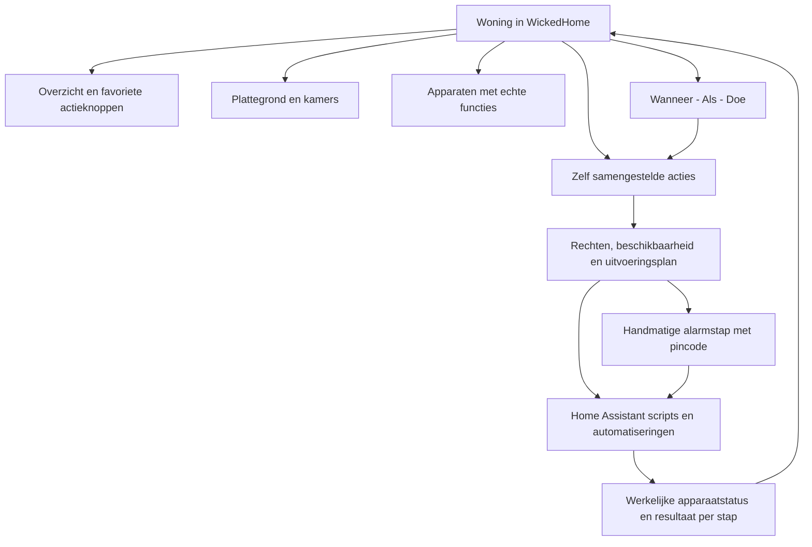
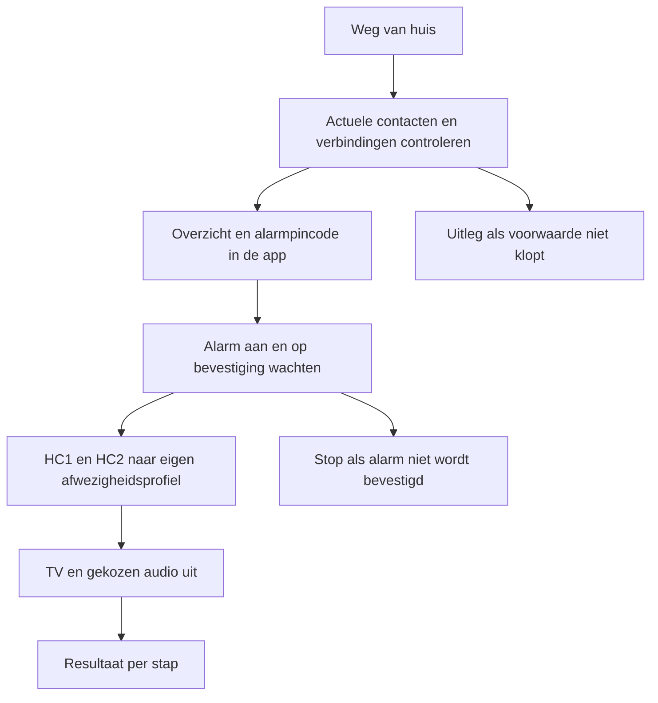

# Woningbediening en eigen acties

WickedHome wordt de dagelijkse bediening voor het huis. Je maakt een actie één keer en gebruikt die als knop, op de kaart of later vanuit een automatisering. Dit is een ontwerpvoorstel; er worden geen apparaten aangestuurd.

<Phase title="Eén herkenbare woninginterface" status="planned">
Vijf ingangen in Woning. Alle apparaten zijn op het grondplan én in het apparatenoverzicht terug te vinden. Beide weergaven openen dezelfde apparaatbediening; actieknoppen hergebruiken dezelfde functies.

<Matrix>
| Ingang | Hoofddoel | Kernfunctie |
|---|---|---|
| Overzicht | Favorieten en aandacht | Actiestatus |
| Plattegrond | Ruimtes en bediening | Kamerinspecteur |
| Apparaten | Functies per toestel | Functiedekking |
| Acties | Knoppen samenstellen | Hergebruik |
| Automatiseringen | Wanneer, als, doe | Uitvoeringslog |
</Matrix>

Overzicht toont echte alarmstatus, open contacten, beide verwarmingscircuits en belangrijke afwijkingen. Een ingestelde woonmodus is een profiel; de alarmstatus blijft afzonderlijk zichtbaar. Uitgeschakelde, onbereikbare en niet-ondersteunde functies hebben elk een herkenbare toestand.

<Callout type="decision">
De plattegrond en het woning-/apparatenoverzicht zijn volwaardige ingangen. Alles krijgt een representatie op de kaart, terwijl dagelijkse bediening en acties ook volledig zonder de kaart werken. Huisbrede functies zoals het alarm krijgen een herkenbaar huisbreed element; gedeelde verwarmingscircuits blijven als gedeelde regeling herkenbaar bij hun ruimtepunten.
</Callout>

| Interactie | Plattegrond | Overzicht en apparaten |
|---|---|---|
| Openen | Kaart zonder bedienpaneel | Status, toestellen en actieknoppen |
| Apparaat kiezen | Klik op het kaartelement | Klik op de apparaatkaart |
| Alarm bedienen | Pas na klik op alarmelement | Via alarmkaart of eigen actie |
| Details sluiten | Kaart krijgt alle ruimte terug | Terug naar het overzicht |

De detailbediening gebruikt op desktop ruimte naast de kaart en bedekt die niet. Op telefoon opent een sluitbaar detailvenster pas na selectie. Een andere verdieping kiezen sluit de vorige kaartselectie. Rechten, beschikbaarheid, functies en status zijn in beide weergaven gelijk; een kaartpositie is geen voorwaarde om een toestel te bedienen.
</Phase>

<Phase title="Apparaatfuncties volledig en begrijpelijk maken" status="planned">
Eén zichtbaar toestel kan meerdere HA-bronnen hebben. Elke functie vermeldt of ze bedienbaar, alleen uitleesbaar, nog te koppelen of niet ondersteund is.

<Matrix>
| Toestelgroep | Dagelijkse bediening | Open werk |
|---|---|---|
| Buderus HC1 en HC2 | Temperatuur en programma | Profielen en hervatten |
| Warm water | Metingen | Modus en extra warm water |
| Verisure | Alarm en contacten | Actie-integratie |
| Camera's | Foto en nieuwe opname | App-livestream ontbreekt |
| TV en audio | Aan/uit, bron, volume | Adapters en groepering |
| Bosch witgoed | Programma en meldingen | Home Connect koppelen |
| Andere functies | Mogelijkheden per toestel | Inventaris en dekking |
</Matrix>

HC1 blijft één circuit voor gelijkvloers en badkamer; de zes radiatorpunten delen HC2. De editor groepeert identieke opdrachten aan hetzelfde circuit en weigert tegenstrijdige instellingen. Controllerwaarden worden niet als afzonderlijke kamermetingen getoond. Eén fysieke Philips-tv krijgt één kaart, met beschikbare functies vanuit de passende integratie.
</Phase>

<Phase title="Eigen actieknoppen met een echte uitvoeringsflow" status="planned">
Acties krijgen naam, pictogram, kleuraccent, favoriete positie, toegestane gebruikers en instelbare stappen. Een lijst met bewerkbare stappen is de eerste editor; uitgebreide vertakkingen kunnen later.

De temperaturen worden door de gebruiker gekozen, afzonderlijk voor HC1 en HC2. Terugkeer kan het tijdprogramma hervatten. Een korte afwezigheid en vakantie kunnen verschillende profielen gebruiken. De waarden in het voorbeeld zijn ontwerpdata, geen aanbevolen verwarmingsinstellingen.

<Callout type="decision">
Het huidige Verisure-paneel vraagt een code om in te schakelen. Acties met een alarmstap starten daarom via de bestaande bevestiging en pincode in de app. De code wordt niet in de actie, het uitvoeringslog of een HA-script opgeslagen. Alarm uitschakelen blijft de bestaande afzonderlijke app-handeling met pincode.
</Callout>

De alarmstap is in de eerste versie een handmatige startvoorwaarde; daarna voert HA de gewone apparaatreeks uit. Een volledig automatische trigger mag deze stap niet stilzwijgend omzeilen. Hiermee behouden we de bestaande alarmregels terwijl gewone huisacties wel automatisch kunnen lopen.
</Phase>

<Phase title="Voorspelbare uitvoering en zichtbare fouten" status="planned">
Elk resultaat onderscheidt aangevraagd, bevestigd, overgeslagen en mislukt. Succes betekent dat de relevante apparaatstatus is bevestigd.

<Matrix>
| Situatie | Gedrag | Resultaat |
|---|---|---|
| TV al uit | Geen opdracht nodig | Al voldaan |
| TV offline | Volgens stapkeuze | Overgeslagen of fout |
| Alarm onbevestigd | Stop | Aandacht nodig |
| Raam open | Voorwaarde uitleggen | Geblokkeerd |
| Dubbele klik | Eén uitvoering | Bestaande run |
| Conflicterende acties | Circuitcoördinator | Geen overlap |
| Server herstart | Toestand opnieuw lezen | Gereconcilieerd |
| Handmatige wijziging | Override respecteren | Actuele instelling |
</Matrix>

Een dry-run toont het uitvoeringsplan zonder service-oproepen. Publiceren en uitvoeren zijn aparte handelingen. Je kunt een actieve reeks stoppen; reeds uitgevoerde stappen worden daardoor niet teruggedraaid. Er komt geen algemene knop die beweert alle effecten veilig ongedaan te maken. Een eerder ingestelde temperatuur herstellen is alleen passend als niemand die ondertussen zelf heeft gewijzigd.
</Phase>

<Phase title="Automatiseren met dezelfde acties" status="planned">
Regels bestaan uit Wanneer, Als en Doe. Ze hergebruiken bestaande acties, met een simulatie en eigen geschiedenis.

<Matrix>
| Wanneer | Als | Doe |
|---|---|---|
| Vast tijdstip | Gekozen dagen | Verwarmingsprofiel |
| Raam langer open | Verwarming actief | Melding |
| Na zonsondergang | Bewoner thuis | Beschikbare verlichting |
| Wasprogramma klaar | Home Connect gekoppeld | Melding |
| Laatste bewoner weg | Aanwezigheid betrouwbaar | Vertrekactie voorstellen |
</Matrix>

Tijdzone Europe/Brussels, zomer-/wintertijd, vertragingen, cooldowns en verlopen triggers horen bij de uitvoering. Achterstallige fysieke acties worden na een herstart niet blind ingehaald. Aanwezigheid en energiesturing volgen pas nadat de benodigde bronnen betrouwbaar zijn gekoppeld en door de gebruiker ingeschakeld.
</Phase>

## Architectuur en bestaande onderdelen

<Callout type="decision">
Mijn voorkeur: WickedHome beheert apparaatpresentatie, actiedefinities, gebruikersrechten en uitvoeringsgeschiedenis. Home Assistant voert de gepubliceerde gewone scripts en regels uit. Een gepubliceerde HA-automatisering blijft daardoor werken als het WickedHome-scherm gesloten is. Handmatige beveiligingsstappen blijven via de bestaande app-dienst lopen.
</Callout>

Eén definitie per actie, één eigenaar van de fysieke uitvoering. Geen tweede onafhankelijke tijdplanner voor dezelfde huisregel. De bestaande achtergrondjobs voor kalender, facturen en synchronisatie behouden hun huidige werking.

| Eigenaar | Verantwoordelijkheid |
|---|---|
| Devices en Places | Bestaande toestellen en kamers |
| Home Assistant-adapters | Beschikbaarheid en getypeerde acties |
| Nieuwe huisacties | Definitie, versie en resultaat |
| HA-publicatie | Script en trigger uitvoeren |
| Alarmdienst | Bevestiging, code en audit |
| Bestaande jobs | Synchronisatie en onderhoud |

Voorstelde gegevens: HomeAction, ActionVersion, ActionStep, ActionRun, StepRun, HomeRule en HeatingProfile. Alle verwijzingen blijven huishoudengebonden en gebruiken bestaande device-ID's en canonieke functiedoelen. Een gepubliceerde versie verandert niet tijdens een lopende actie. Afwijkingen na handmatig aanpassen in HA worden zichtbaar, niet overschreven.

<FileTree>
- modify src/features/devices/ -- uniforme bediening en kaartinspecteur
- modify src/features/home-assistant/ -- media, verwarmingsmodi en functiedekking
- add src/features/home-actions/ -- actie-editor en uitvoeringsresultaten
- add src/api/home-actions/ -- getypeerde definities, planning en publicatie
- add prisma/schema/home-actions.prisma -- acties, versies en runs
- modify src/routes/house.tsx -- woningoverzicht en bestaande kaart behouden
- add stories/features/home-actions/ -- toestanden, fouten en responsive flows
</FileTree>

## Bestaand en nog te bouwen

Bestaand: 39 WickedHome-apparaatrecords, kaartpunten en losse bediening; 129 HA-entiteiten in de laatste controle. De acht verwarmingspunten vertegenwoordigen twee gedeelde circuits. TV/audio, functionele groepsbediening en een eigen routine-editor zijn nog uitbreiding. HA heeft op dit moment nog geen script-/automation-configuratie voor de voorgestelde publicatie; dat wordt gecontroleerd toegevoegd zonder bestaande instellingen te vervangen.

Camera-snapshots werken voor Living, Keuken en Garage. Livestreaming blijft afhankelijk van de nog ontbrekende telefoonapp-koppeling. Home Connect is nog niet in HA gekoppeld. Lokale Buderus-bediening is actief; automatisch omschakelen naar de cloud is apart werk.

## Leveringsvolgorde

1. Functie-inventaris, uniforme apparaatkaarten en media-/verwarmingsbediening.
2. Zelf definieerbare knoppen, dry-run en handmatige Weg van huis / Thuis / Slapen / TV-avond.
3. Duurzame uitvoering, foutafhandeling en publicatie naar HA als één samenhangende levering met stap 2.
4. Tijd- en sensorregels; daarna aanwezigheid en energiesturing.

<Checklist title="Gereed wanneer">
- [ ] Elk bekend apparaat heeft een kaartrepresentatie én een ingang in het apparatenoverzicht.
- [ ] De kaart opent zonder alarmbediening of ander permanent detailpaneel.
- [ ] Alleen het gekozen element toont zijn bediening; sluiten en verdieping wisselen wissen de kaartselectie.
- [ ] Dezelfde apparaatfuncties, rechten en actuele status werken vanuit beide weergaven.
- [ ] Favoriete acties en volledige apparaatbediening werken zonder de kaart te openen.
- [ ] Elke bekende functie heeft een zichtbare dekkingstatus.
- [ ] Eén TV heeft één kaart en HC2 heeft één regeldoel.
- [ ] Zelf een actie maken, wijzigen en publiceren werkt op telefoon en desktop.
- [ ] Dry-run roept geen fysieke service aan.
- [ ] Alarmcode komt niet in definities, traces of logs.
- [ ] Een opdracht is pas bevestigd na de relevante toestand.
- [ ] Offline, afgebroken, dubbel gestarte en gedeeltelijke runs zijn getest.
- [ ] Opnieuw verbinden en herstart voeren geen oude fysieke opdracht blind opnieuw uit.
- [ ] Bestaande kaartlinks, apparaatdetails en app-automatiseringen blijven werken.
</Checklist>

<Questions>
- Welke startweergave past het beste?
  - Overzicht met favoriete actieknoppen en kamers (aanbevolen)
  - Plattegrond als eerste scherm
</Questions>

## Bronnen

- [HA automatiseringen](https://www.home-assistant.io/docs/automation/)
- [Stappen en foutafhandeling](https://www.home-assistant.io/docs/automation/building-blocks/)
- [Gedrag bij overlappende uitvoeringen](https://www.home-assistant.io/docs/automation/modes/)
- [Mediafuncties](https://www.home-assistant.io/integrations/media_player/)
- Bestaande code: `docs/DEVICES.md`, `docs/AUTOMATIONS.md`, `ha-control.ts`, `ha-alarm.ts`, `alarm-guard.ts` en de woningroute.
