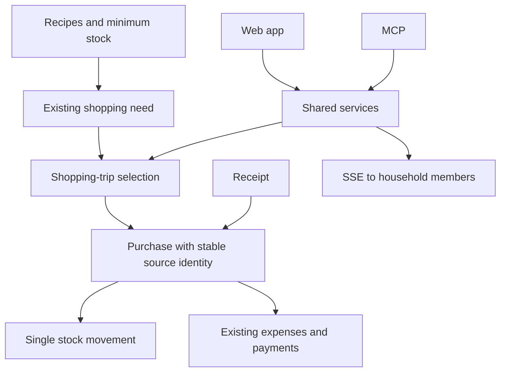

# WickedHome — reliable shared shopping

Historical implementation plan, translated into English. Existing products, shopping needs, stock movements, purchase evidence and expenses are retained. The six phases below describe completed implementation work. The [application-wide redesign](./application-redesign/plan.mdx) is the current proposal for navigation and interface composition; this plan is not evidence of the current server revision.

<Phase title="1. Repair existing defects" status="done">
<Checklist>
- [x] Purchases suppress immediate automatic repetition
- [x] Historical purchases do not block independent acquisitions
- [x] Source identities stay idempotent
</Checklist>
</Phase>

<Phase title="2. Make shopping understandable" status="done">
<FileTree>
- modify src/features/shopping/components/ -- categories, order, source filter and skipping
- modify src/api/shopping/shopping.service.ts -- shared status logic
</FileTree>
</Phase>

<Phase title="3. Shopping trips and receipts" status="done">
<FileTree>
- add prisma/schema/shopping-sessions.prisma -- sessions, participants, purchases and receipt links
- add src/api/shopping/sessions.service.ts -- transactions and source checks
- add src/features/shopping/screens/sessions-screen.tsx -- selection, checklist and history
</FileTree>
</Phase>

<Phase title="4. Realtime and concurrent actions" status="done">
<Checklist>
- [x] Extend the existing SSE mechanism from service boundaries
- [x] Revision checks prevent lost updates
- [x] Reconnection loads current records
</Checklist>
</Phase>

<Phase title="5. Financial links" status="done">
<FileTree>
- modify src/api/shopping/sessions.service.ts -- coordinate existing expenses and split payments
- modify src/features/shopping/screens/sessions-screen.tsx -- browse purchase, receipt and expense together
</FileTree>
</Phase>

<Phase title="6. Consistency and delivery" status="done">
<Checklist>
- [x] Count jars without mandatory weights; compare explicit packaging safely
- [x] Verify migration on a disposable database with existing records
- [x] Test API, MCP, concurrency, receipt retries and realtime
- [x] Record files, migrations, results and limits for each phase
</Checklist>
</Phase>

Recorded implementation validation: 1,603 unit tests, 23 PostgreSQL/MCP integration tests, two mobile browsers and preservation of representative pre-migration data. See [the implementation report](../SHOPPING-SESSIONS.md). These counts describe that delivery, not a new domain test run during documentation translation.
