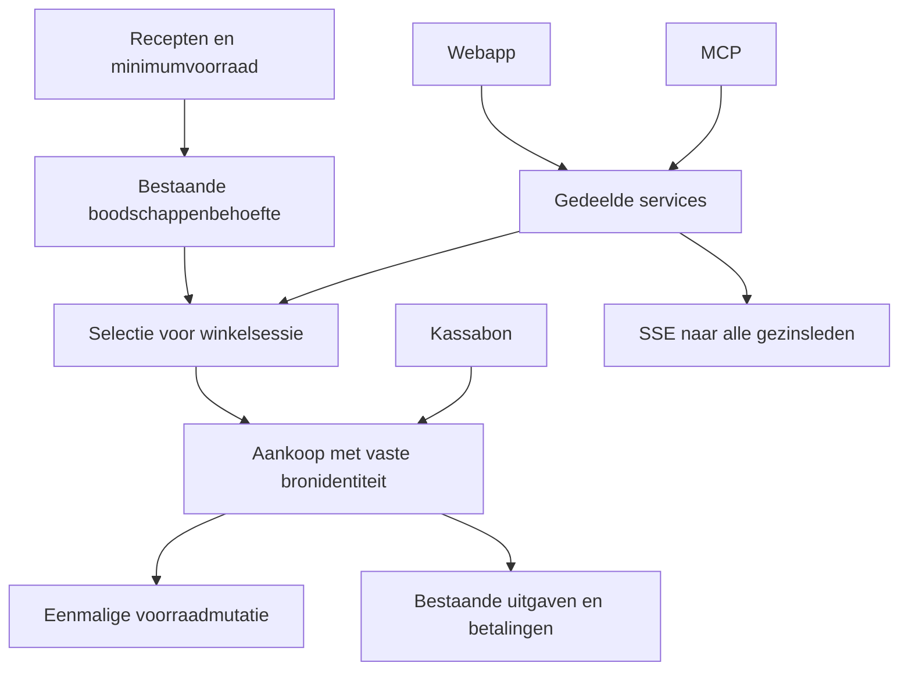

# WickedHome: betrouwbaar samen winkelen

De bestaande productcatalogus, boodschappenregels, voorraadmutaties, aankoopbewijzen en uitgaven blijven behouden. Implementatie in zes geteste fases.

<Phase title="1. Bestaande fouten herstellen" status="active">

<Checklist>
- [ ] Aankopen onderdrukken onmiddellijke automatische herhaling
- [ ] Historische aankopen blokkeren geen onafhankelijke aankoop
- [ ] Bronidentiteiten blijven idempotent
</Checklist>

</Phase>

<Phase title="2. Boodschappen overzichtelijk maken" status="planned">

<FileTree>
- modify src/features/shopping/components/ -- categorieën, volgorde, herkomstfilter en overslaan
- modify src/api/shopping/shopping.service.ts -- gedeelde statuslogica
</FileTree>

</Phase>

<Phase title="3. Winkelsessies en kassabonnen" status="planned">

<FileTree>
- add prisma/schema/shopping-sessions.prisma -- sessies, deelnemers, aankopen en bonkoppelingen
- add src/api/shopping/sessions.service.ts -- transacties en broncontrole
- add src/features/shopping/screens/sessions-screen.tsx -- selectie, afvinken en historiek
</FileTree>

</Phase>

<Phase title="4. Realtime en gelijktijdige acties" status="planned">

<Checklist>
- [ ] Bestaande SSE uitbreiden vanuit de servicelaag
- [ ] Revisiecontrole voorkomt verloren wijzigingen
- [ ] Opnieuw verbinden haalt actuele gegevens op
</Checklist>

</Phase>

<Phase title="5. Financiële koppeling" status="planned">

<FileTree>
- modify src/api/shopping/sessions.service.ts -- bestaande uitgaven en gesplitste betalingen koppelen
- modify src/features/shopping/screens/sessions-screen.tsx -- aankoop, bon en uitgaven samen raadplegen
</FileTree>

</Phase>

<Phase title="6. Consistentie en oplevering" status="planned">

<Checklist>
- [ ] Verpakkingen alleen via verifieerbare hoeveelheden vergelijken
- [ ] Migratie op wegwerpdatabase met bestaande gegevens controleren
- [ ] API, MCP, concurrentie, bonherhaling en realtime testen
- [ ] Rapport per fase met bestanden, migraties, resultaten en beperkingen
</Checklist>

</Phase>
