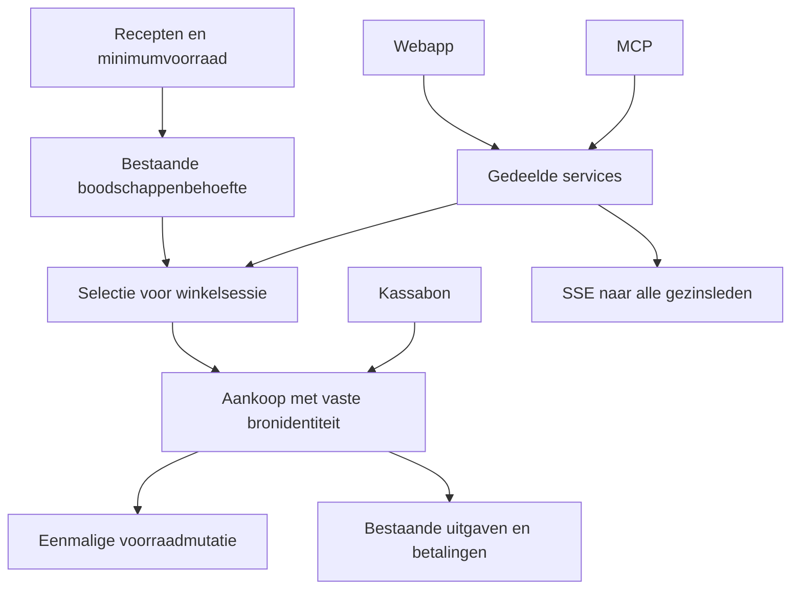

# WickedHome: betrouwbaar samen winkelen

De bestaande productcatalogus, boodschappenregels, voorraadmutaties, aankoopbewijzen en uitgaven blijven behouden. Implementatie in zes geteste fases.

<Phase title="1. Bestaande fouten herstellen" status="done">

<Checklist>
- [x] Aankopen onderdrukken onmiddellijke automatische herhaling
- [x] Historische aankopen blokkeren geen onafhankelijke aankoop
- [x] Bronidentiteiten blijven idempotent
</Checklist>

</Phase>

<Phase title="2. Boodschappen overzichtelijk maken" status="done">

<FileTree>
- modify src/features/shopping/components/ -- categorieën, volgorde, herkomstfilter en overslaan
- modify src/api/shopping/shopping.service.ts -- gedeelde statuslogica
</FileTree>

</Phase>

<Phase title="3. Winkelsessies en kassabonnen" status="done">

<FileTree>
- add prisma/schema/shopping-sessions.prisma -- sessies, deelnemers, aankopen en bonkoppelingen
- add src/api/shopping/sessions.service.ts -- transacties en broncontrole
- add src/features/shopping/screens/sessions-screen.tsx -- selectie, afvinken en historiek
</FileTree>

</Phase>

<Phase title="4. Realtime en gelijktijdige acties" status="done">

<Checklist>
- [x] Bestaande SSE uitbreiden vanuit de servicelaag
- [x] Revisiecontrole voorkomt verloren wijzigingen
- [x] Opnieuw verbinden haalt actuele gegevens op
</Checklist>

</Phase>

<Phase title="5. Financiële koppeling" status="done">

<FileTree>
- modify src/api/shopping/sessions.service.ts -- bestaande uitgaven en gesplitste betalingen koppelen
- modify src/features/shopping/screens/sessions-screen.tsx -- aankoop, bon en uitgaven samen raadplegen
</FileTree>

</Phase>

<Phase title="6. Consistentie en oplevering" status="done">

<Checklist>
- [x] Potjes tellen zonder verplicht gewicht; expliciete verpakkingen veilig vergelijken
- [x] Migratie op wegwerpdatabase met bestaande gegevens controleren
- [x] API, MCP, concurrentie, bonherhaling en realtime testen
- [x] Rapport per fase met bestanden, migraties, resultaten en beperkingen
</Checklist>

</Phase>

Uitgevoerd en gevalideerd: 1.600 unittests, 21 PostgreSQL/MCP-integratietests, twee mobiele browsers en behoud van bestaande migratiegegevens. Details staan in `docs/SHOPPING-SESSIONS.md`.
